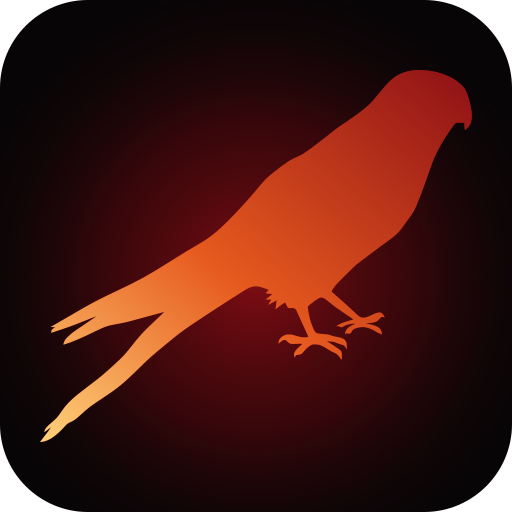

<div align="center">
  
  <h1>Kestrel</h1>
  <p><strong>A UCI chess engine built for human opposition.</strong></p>
  <p>
    
    
    
    
  </p>
</div>

## Overview

Kestrel is a free, open-source UCI chess engine derived from
[Patricia 5.1](https://github.com/Adam-Kulju/Patricia) by Adam Kulju. It inherits
Patricia's search, embedded NNUE evaluation, and UCI interface. The project's
long-term goal is to choose moves that are difficult for human opponents to
defend, rather than simply maximizing an engine evaluation.

Kestrel is an engine, not a chess GUI. Use it with any UCI-compatible chess
interface, or drive it directly from a terminal.

## Status

**Current build: 0.1.0 (alpha).** This is the initial source fork. The engine
builds, speaks UCI, and includes a working Windows binary, but the
human-opponent selection layer is not implemented yet. The current binary is a
Patricia 5.1 baseline with Kestrel's identity and build configuration. No
independent Kestrel rating or strength claim is being made.

## Files

| Path | Contents |
| --- | --- |
| `engine/` | Patricia-derived C++20 source, NNUE networks, and Makefile |
| `bin/windows-x86_64/kestrel-0.1.0-avx2.exe` | Precompiled Windows x86-64 binary |
| `assets/kestrel-logo.svg` | Kestrel logo |
| `tests/uci-smoke.ps1` | UCI handshake smoke test |
| `SHA256SUMS` | SHA-256 checksum for the checked-in binary |
| `LICENSE` | MIT license and original Patricia notice |
| `AUTHORS` | Engine, fork, and logo credits |
| `CONTRIBUTING.md` | Build, test, and pull-request guidance |

## Download

The precompiled Windows x86-64 build is available here:

**[kestrel-0.1.0-avx2.exe](bin/windows-x86_64/kestrel-0.1.0-avx2.exe)**

SHA-256:

```text
b0051dec8ceea129e0e3fef33b0c9e6df5de185b1b406df291f31fd6073f5b58
```

This binary targets x86-64-v3 and requires AVX2 and BMI2. The NNUE networks are
embedded in the executable, so there are no runtime files to download. There is
no installer; place the executable wherever you keep your engines and select it
from your UCI client.

## Building from source

### Requirements

- A C++20 compiler (`g++` or `clang++`)
- GNU Make
- Windows: a MinGW-w64 toolchain. The checked binary was produced with GCC
  16.2.0 from [w64devkit](https://github.com/skeeto/w64devkit).

### Build

From the repository root:

```bash
make
```

Or build the engine directly:

```bash
make -C engine
```

The output is `engine/kestrel.exe` on Windows and `engine/kestrel` on
Unix-like systems. To use Clang instead of GCC:

```bash
make -C engine CXX=clang++
```

The default x86-64 build uses `-march=x86-64-v3` (AVX2 and BMI2). For a native
build, a different target, or a generic binary, override `CXXFLAGS` in
`engine/Makefile`.

To remove build products:

```bash
make -C engine clean
```

## Usage

Kestrel communicates over the Universal Chess Interface. Connect it to a UCI
client such as BanksiaGUI, Cute Chess, Arena, En Croissant, or Nibbler. Kestrel
does not draw a board or manage a game database.

A minimal terminal session looks like this:

```text
$ ./kestrel.exe
uci
isready
position startpos
go movetime 1000
quit
```

The engine also exposes Patricia's command-line test commands:

```bash
./kestrel.exe bench
./kestrel.exe perft 5
```

Use `perft` with the depth you want to verify; `bench` runs the engine's
built-in benchmark.

## UCI options

| Option | Type | Default | Range / notes |
| --- | --- | --- | --- |
| `Hash` | spin | 32 | 1–131072 MB |
| `Threads` | spin | 1 | 1–1024 |
| `SyzygyPath` | string | `null` | Path to Syzygy tablebases |
| `MultiPV` | spin | 1 | 1–255 |
| `Skill_Level` | spin | 21 | 1–21 |
| `Move_Overhead` | spin | 50 | 0–5000 ms |
| `UCI_Chess960` | check | `false` | Enable Chess960 mode |

These options are inherited from Patricia 5.1.

## Strength and style

Kestrel 0.1.0 inherits Patricia 5.1's search and NNUE evaluation. It has not
been independently rated, and this repository does not publish a Kestrel
rating. The purpose of the fork is to add a human-opponent move-selection layer
on top of that baseline. Until that layer exists, evaluate Kestrel as a
Patricia 5.1 baseline with a new identity and build configuration.

## Relationship to Patricia

Kestrel is derived from Patricia 5.1 by Adam Kulju and is distributed under the
same MIT license. Kestrel is not affiliated with or endorsed by Adam Kulju. The
original copyright and permission notice is preserved in [`LICENSE`](LICENSE).

## Testing

On Windows, run the UCI smoke test from the repository root:

```powershell
powershell -NoProfile -ExecutionPolicy Bypass -File tests/uci-smoke.ps1
```

The test starts the checked-in binary, sends `uci` and `quit`, and verifies the
engine identity and `uciok` response.

## Contributing

See [`CONTRIBUTING.md`](CONTRIBUTING.md). Keep changes focused, build and test
the engine before opening a pull request, and submit only code that can be
distributed under the MIT license.

## Acknowledgements

- **Adam Kulju** for Patricia 5.1, the engine this fork is built from.
- **Ferran Sayol** for the CC0 kestrel silhouette used in the logo.
- Patricia's original acknowledgements remain relevant to the inherited engine.

## License

Kestrel is released under the MIT License. See [`LICENSE`](LICENSE) for the
full text and the original Patricia copyright notice.

> **Not part of the license:** Kestrel accepts no responsibility for bruised
egos. The actual legal terms are the MIT text in [`LICENSE`](LICENSE).
